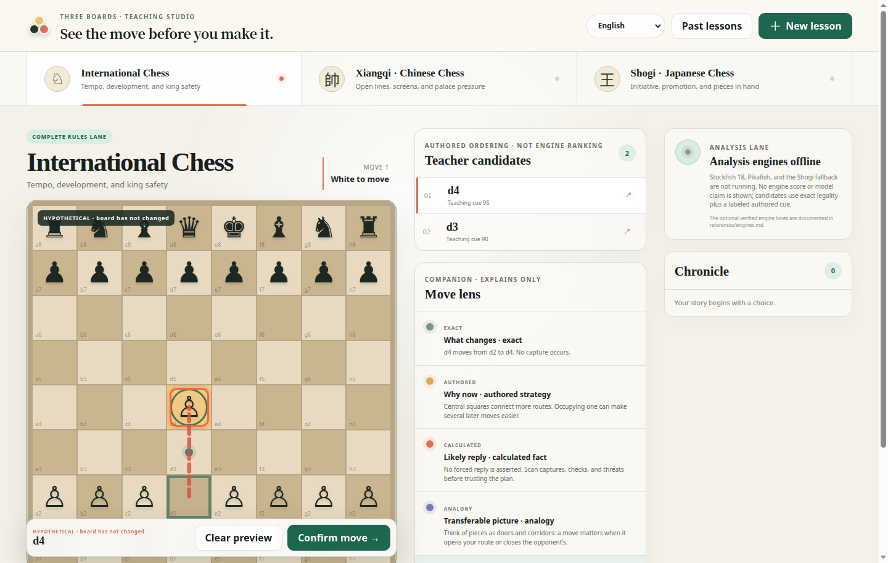

[English](../README.md) · [العربية](README.ar.md) · [Español](README.es.md) · [Français](README.fr.md) · [日本語](README.ja.md) · [한국어](README.ko.md) · [Tiếng Việt](README.vi.md) · [中文 (简体)](README.zh-Hans.md) · [中文（繁體）](README.zh-Hant.md) · [Deutsch](README.de.md) · [Русский](README.ru.md)

[](https://lazying.art)

# LazyChess

*Voyez le coup avant de le jouer, aux Échecs, au Xiangqi et au Shogi.*

[](https://lazying.art) [](../docs/images/app.png) [](https://github.com/sponsors/lachlanchen)

LazyChess est un studio pédagogique local-first pour les Échecs internationaux, le Xiangqi et le Shogi. L’élève examine les intentions légales, prévisualise un plateau hypothétique immuable, lit des explications dont la provenance est visible, puis confirme explicitement avant que les règles déterministes ne modifient la partie.

| Donate | PayPal | Stripe |
| --- | --- | --- |
| [](https://chat.lazying.art/donate) | [](https://paypal.me/RongzhouChen) | [](https://buy.stripe.com/aFadR8gIaflgfQV6T4fw400) |

## Aperçu



La Carte de position propre à chaque jeu sépare le contrôle exact des cases et les contacts entre pièces, les trajets calculés et les perspectives d’échange fondées sur les seuls contacts, les plans élaborés par les auteurs et les variantes moteur bornées. Le survol ou le focus prévisualise les mêmes preuves sans jouer ; seule une confirmation explicite modifie la partie. Les onze langues de l’application respectent une parité stricte des catalogues et paramètres ; l’arabe active aussi la direction droite-à-gauche.

## Trois voies de règles

| Mode | Autorité déterministe | Limite actuelle |
| --- | --- | --- |
| Échecs internationaux | `chess.js` 1.4.0 | Légalité standard, échec, roque, prise en passant, promotion, mat et détection des nulles par la bibliothèque |
| Xiangqi | Adaptateur TypeScript rédigé | Noyau pédagogique : mouvements, jambe du cheval, écrans du canon, rivière, palais, généraux face à face, sécurité en échec et défaite sans coup ; arbitrage répétition/poursuite différé |
| Shogi | Adaptateur TypeScript rédigé | Noyau pédagogique : mouvements, parachutages, captures en main, promotion, nifu, sécurité en échec et défaite sans coup ; répétition, échec perpétuel et mat par parachutage de pion différés |

Le compagnon explique mais ne joue pas. Les moteurs facultatifs fournissent uniquement des preuves bornées et ne modifient jamais l’état faisant autorité.

## Carte de position et analyse

- **Contrôle** montre les attaques et défenses propres aux règles, notamment les attaques de pions, les écrans de canon et jambes du cheval du Xiangqi, ainsi que les parachutages du Shogi séparément de la mobilité légale.
- **Sécurité** signale les pièces défendues, attaquées, en prise sans protection, sauvées et nouvellement exposées, sans prétendre qu’un simple contact prouve une prise.
- **Lignes** trace les trajets des pièces à longue portée propres à chaque variante, les lignes ouvertes, les écrans de canon et les zones de promotion — pas un nuage de territoire emprunté au Go.
- La **zone du roi** compare les cases mettant le roi en échec, les cases hostiles autour de lui et ses destinations exactement légales, y compris la contrainte des généraux face à face du Xiangqi.
- Un plateau neuf propose une seule suggestion pédagogique clairement hypothétique. Le survol, le focus ou le toucher compare l’avant et l’après ; un clic droit ou Escape (Échap) l’efface ; **Confirmer** est la seule mutation.
- Stockfish et Pikafish peuvent ajouter des preuves bornées de scores et variantes principales (PV) de moteurs spécialisés. Fairy-Stockfish est clairement signalé comme solution classique de repli pour le Shogi. Chaque voie moteur indique le point de vue du camp racine, la limite de recherche, la profondeur, les nœuds, le temps, la provenance du code source et du binaire, ainsi que son échelle de score native non comparable entre variantes de jeu.

## Carte du dépôt

| Chemin | Rôle |
| --- | --- |
| `src/domain/` | Règles déterministes, candidats, facettes pédagogiques et persistance |
| `src/i18n/` | Onze catalogues complets et tests de parité |
| `references/engines.md` | Provenance des moteurs facultatifs et contrat d’installation vérifié |
| `scripts/` | Contrôles de sécurité, installation et vérification des moteurs |
| `docs/images/app.png` | Capture actuelle de l’application |

## Démarrage rapide

Nécessite Node.js `^20.19.0` ou `>=22.12.0`.

```bash
npm ci
npm run dev
```

Vite écoute sur loopback par défaut. Le choix de langue est conservé par une liste blanche explicite de 11 valeurs ; toute valeur inconnue revient sûrement à l’anglais.

## Contrat pédagogique déterministe

- Les identifiants de candidat lient l’état complet, l’acteur et l’action canonique.
- Les aperçus dérivent un état immuable et n’écrivent jamais dans le stockage.
- Les sélections périmées, inconnues, du mauvais acteur ou postérieures à la fin échouent de manière fermée.
- Les affirmations exactes, calculées, rédigées, moteur, modèle et analogie gardent des étiquettes de provenance séparées.
- Les réponses envisagées à un coup candidat sont des échantillons bornés de caractéristiques qui forcent une réponse, pas des variantes moteur ni des prédictions présentées comme forcées ; les perspectives matérielles utilisent une échelle de valeur des pièces explicitement définie par les auteurs.
- L’analyse est liée au jeton d’état complet et à l’acteur. Une preuve moteur ou candidate périmée est rejetée plutôt que repeinte sur une position plus récente.
- Les limites du Xiangqi et du Shogi restent visibles plutôt que présentées comme un arbitrage complet.

## Validation

```bash
npm run check
git diff --check
```

La suite couvre des règles représentatives, l’analyse du Shogi à forte ramification, les candidats liés à l’état, les aperçus immuables, les preuves de prise en passant/canon/généraux face à face/parachutage, l’idempotence, les courses de persistance, la reprise des sessions, le protocole moteur borné et la sécurité des chemins, la parité des 11 langues, la persistance de la langue, la direction RTL et la confirmation explicite.

## Citation

Si vous utilisez LazyChess en recherche, citez le dépôt. GitHub lit [CITATION.cff](../CITATION.cff) et affiche un panneau **Cite this repository** sur la page du projet.

```bibtex
@software{chen_three_boards_teacher_2026,
  author  = {Chen, Lachlan},
  title   = {Three Boards Teacher: International Chess, Xiangqi, and Shogi},
  year    = {2026},
  version = {0.1.0},
  url     = {https://github.com/lachlanchen/LazyChess}
}
```

## État et licence

L’application pédagogique est local-first et sous licence MIT. `chess.js` est sous BSD-2-Clause. Stockfish, Pikafish et Fairy-Stockfish restent des programmes GPL-3.0 installés séparément et ne sont pas inclus.
